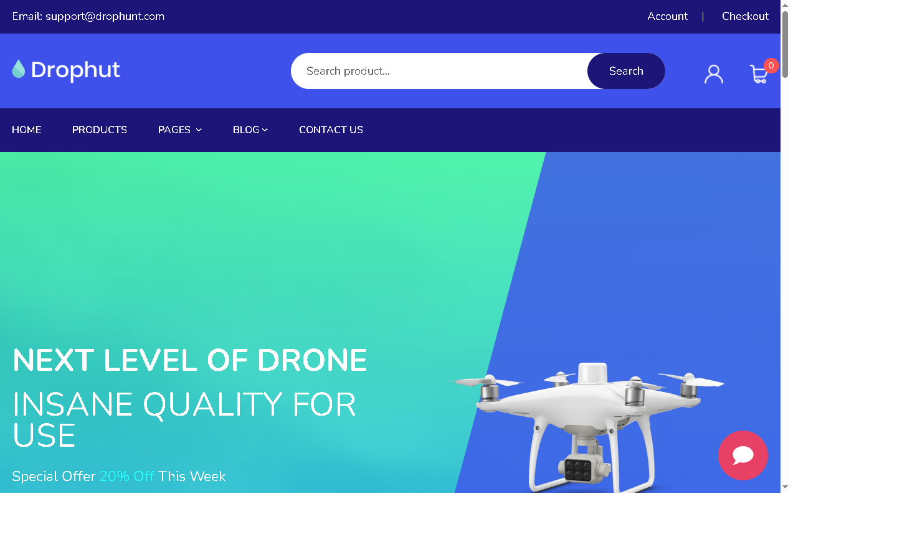

# Drophut Drone Store

A procedural PHP and MySQLi e-commerce learning project for browsing drones and accessories, managing a session-based cart, checking out, tracking orders, and administering products and orders.



*Storefront home page preview. The floating chat button opens the n8n-powered customer assistant.*

## Features

### Storefront

- Product listing and product detail pages backed by MySQL.
- Customer registration and login with hashed passwords.
- Session-based cart with stock validation and server-side totals.
- Login-required wishlist.
- Profile editing and customer-owned order history/details.
- Transactional cash-on-delivery checkout, stock updates, and order tracking.
- n8n chat widget on customer storefront pages.

### Admin

- Separate Admin login and protected Admin routes.
- Product create, list, edit, delete, and image upload.
- Order approval (`processing`) and rejection (`cancelled`) from the dashboard.
- Rejection restores reserved stock and writes a tracking update.
- n8n assistant embedded in the dashboard.

## Technology

- PHP 8+ with procedural functions (no OOP/framework).
- MySQL with MySQLi (`mysqli_query()`).
- HTML, CSS, Bootstrap, and JavaScript.
- n8n Chat widget loaded from jsDelivr and connected to the configured Chat Trigger webhook.

## Run locally with Laragon

1. Install/start Laragon with Apache, PHP, and MySQL.
2. Put this repository in `C:\laragon\www\dron-store2`.
3. Open phpMyAdmin or HeidiSQL and import [`database.sql`](database.sql). It creates the project's required tables without dropping existing tables or rows. Back up any database you care about before importing.
4. Check [`config/db.php`](config/db.php). The default connection is `localhost`, MySQL user `root`, an empty password, and database `drone_store`. Adjust the connection values if your Laragon setup differs.
5. Open [http://localhost/dron-store2/](http://localhost/dron-store2/).
6. Create a customer account, add products to the database, and try the storefront flows.

### First Admin account

1. Open [http://localhost/dron-store2/?route=admin-pages-login](http://localhost/dron-store2/?route=admin-pages-login).
2. If the `admins` table has no account, use the registration link to create the first Admin.
3. After the first Admin is registered, public Admin registration closes. Sign in with that account to manage products and orders.

Never publish a weak or shared Admin password.

### n8n chat setup

The customer and Admin chat widgets use the n8n Chat Trigger webhook configured in the PHP templates. For the chat to answer:

1. Activate the n8n workflow and its Chat Trigger.
2. In the Chat Trigger's **Allowed Origins (CORS)** setting, add every domain used to access the store. For local testing, this may be `http://localhost`; add your production domain when deployed.
3. Confirm the production webhook URL matches the one configured in [`inc/header.php`](inc/header.php) and [`admin/views/dashboard/index.php`](admin/views/dashboard/index.php).
4. Send a test message from both the storefront and the Admin dashboard.

[`n8n/store-knowledge.json`](n8n/store-knowledge.json) contains store FAQ and response guidance for the workflow; it is not an n8n workflow export. Do not expect live AI responses unless the external workflow is active and configured.

## Architecture

This project uses a small front-controller / MVC-style organization with procedural functions:

```text
index.php                 Route dispatcher
config/db.php             Shared MySQLi connection
controller/               Customer request handlers and shared helpers
models/                   Customer database and cart functions
views/                    Customer-facing pages
inc/                      Shared storefront header and footer
admin/controllers/         Admin routes and request handling
admin/models/              Admin database functions
admin/views/               Admin pages and dashboard
database.sql               Database schema
n8n/                       Store assistant knowledge content


## Database notes

- The cart is stored in the PHP session; no separate cart table is used.
- Products and their images use the existing `products` and `product_images` tables.
- `database.sql` defines the additional `admins`, `wishlists`, `shipping_addresses`, `orders`, `order_items`, `payments`, and `tracking_logs` tables used by the implemented features.
- Checkout uses a MySQL transaction so the address, order, items, payment, stock, and initial tracking entry succeed or roll back together.
- The payment flow records cash on delivery. It does not process credit cards or PayPal.

## Security and learning limitations

This project intentionally uses `mysqli_query()` and `mysqli_real_escape_string()` to match the learning requirements. **Escaping is not equivalent to prepared statements.** Prepared statements are strongly recommended before exposing any application to the public internet.

The code also uses password hashing, server-side validation, HTML output escaping, session checks, CSRF tokens, and ownership checks. These measures do not make the requested SQL style suitable for production by themselves. Change default credentials, use a least-privilege database account, configure HTTPS, and review the application before deployment.

Some original NiceAdmin dashboard charts and summary cards still display template sample values and are not live business analytics.

## Verification

The implemented backend flows were tested with PHP syntax checks and isolated database tests for authentication, cart/wishlist operations, transactional checkout, Admin product CRUD, order approval/rejection, stock restoration, and access controls. Storefront/Admin pages were also checked through a local PHP server. The external n8n service must be active to verify actual AI responses.
