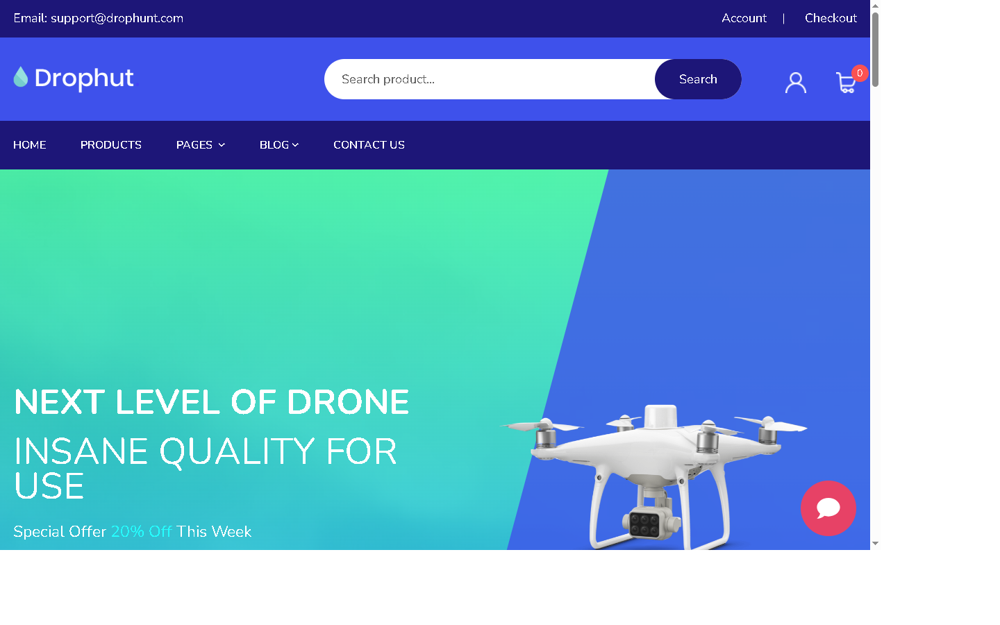

# Drophut Drone Store

A procedural PHP and MySQLi e-commerce learning project for browsing drones and accessories, managing a session-based cart, checking out, tracking orders, and administering products and orders.



*Storefront home page preview. The floating chat button opens the n8n-powered customer assistant.*

## Features

### Storefront

- A responsive storefront with a muted hero video that autoplays where allowed, respects reduced-motion settings, and provides native controls plus a poster fallback when playback is blocked or unsupported. Live product listings include catalog search, category filters, sorting, and pagination.
- Customer registration and login with hashed passwords.
- Session-based cart with stock validation and server-side totals.
- Login-required wishlist.
- Profile editing and customer-owned order history/details.
- Transactional cash-on-delivery checkout, stock updates, and order tracking.
- n8n chat widget on customer storefront pages.

### Admin

- Separate Admin login and protected Admin routes.
- Product create, list, search, edit, delete, and image upload.
- Live dashboard metrics, recent orders, top-selling products, stock alerts, sales and COD collection trends, order fulfillment charts, and product-category sales charts for the latest 7, 30, or 90 days.
- Order fulfillment from the dashboard: `pending` to `processing`, `processing` to `shipped`, and `shipped` to `delivered`. Pending or processing orders can be cancelled.
- Cancellation restores reserved stock and writes a tracking update. Marking a COD order delivered records the payment as paid.
- n8n assistant embedded in the dashboard.

## Technology

- PHP 8+ with procedural functions (no OOP/framework).
- MySQL with MySQLi (`mysqli_query()`).
- HTML, CSS, Bootstrap, and JavaScript.
- n8n Chat widget loaded from jsDelivr and connected to the configured Chat Trigger webhook.

## Run locally with Laragon

1. Install/start Laragon with Apache, PHP, and MySQL.
2. Put this repository in `C:\laragon\www\dron-store2`.
3. From the project folder, run `php database/migrate.php`. It creates the database and tables, records the initial migration, then loads the fictional demo catalog, customers, and orders. It is safe to rerun and does not drop existing tables or rows.
4. The default database connection is `localhost`, MySQL user `root`, an empty password, and database `drone_store`. Set `DRONE_STORE_HOST`, `DRONE_STORE_USER`, `DRONE_STORE_PASSWORD`, `DRONE_STORE_DB`, or `DRONE_STORE_PORT` before running the migration if your setup differs. Configure the same values for Apache/PHP.
5. Open [http://localhost/dron-store2/](http://localhost/dron-store2/), create the first Admin account, and try the storefront flows.

To create or update only the schema without adding sample sales, run `php database/migrate.php --skip-demo-data`. You can also import [`database.sql`](database.sql) manually into MySQL; the migration command is the recommended setup path.

### Optional demo catalog and sales data

To populate the local store and analytics dashboard with fictional examples, run:

```powershell
php database/seed_demo_data.php
```

The script adds eight drone and accessory products, twelve fictional customer profiles, and 36 sample cash-on-delivery orders with order items and tracking events. It uses reserved `.invalid` email addresses, randomly generated password hashes that are not disclosed, and order numbers beginning with `DEMO-`; it never updates or deletes existing records. It is safe to run again: existing demo products, customers, and orders are left unchanged. These records are for development/demo use, not real sales.

### First Admin account

1. Open [http://localhost/dron-store2/?route=admin-pages-login](http://localhost/dron-store2/?route=admin-pages-login).
2. _ account : admmin@gmail.com   pw:123 
3. If the `admins` table has no account, use the registration link to create the first Admin.
4. After the first Admin is registered, public Admin registration closes. Sign in with that account to manage products and orders.

Never publish a weak or shared Admin password.

### Admin password reset email

The Admin sign-in page includes a password-reset link. Reset links are single-use and expire after one hour. To deliver them, configure PHP's `mail()` transport and set these environment variables for both PHP CLI and Apache:

```text
DRONE_STORE_BASE_URL=http://localhost/dron-store2
DRONE_STORE_MAIL_FROM=no-reply@example.com
```

Use your real HTTPS site URL and a sender address accepted by your mail provider in production. Without a configured mail transport, an Admin who can still sign in can change their password from the Admin profile page; lost-password email recovery will report that mail is not configured.

### n8n chat setup

The customer and Admin chat widgets use the n8n Chat Trigger webhook configured in the PHP templates. For the chat to answer:

1. Activate the n8n workflow and its Chat Trigger.
2. In the Chat Trigger's **Allowed Origins (CORS)** setting, add every domain used to access the store. For local testing, this may be `http://localhost`; add your production domain when deployed.
3. Confirm the production webhook URL matches the one configured in [`inc/header.php`](inc/header.php) and [`admin/views/dashboard/index.php`](admin/views/dashboard/index.php).
4. Send a test message from both the storefront and the Admin dashboard.

[`n8n/store-knowledge.json`](n8n/store-knowledge.json) contains store FAQ and response guidance for the workflow; it is not an n8n workflow export. Do not expect live AI responses unless the external workflow is active and configured.

## Architecture

This project uses a small front-controller / MVC-style organization with procedural functions:

```text
index.php                 Route dispatcher
config/db.php             Shared MySQLi connection
controller/               Customer request handlers and shared helpers
models/                   Customer database and cart functions
views/                    Customer-facing pages
inc/                      Shared storefront header and footer
admin/controllers/         Admin routes and request handling
admin/models/              Admin database functions
admin/views/               Admin pages and dashboard
database.sql               Database schema
n8n/                       Store assistant knowledge content
```

## Database notes

- The cart is stored in the PHP session; no separate cart table is used.
- Products and their images use the existing `products` and `product_images` tables.
- `database.sql` defines the `admins`, `admin_password_resets`, `schema_migrations`, `wishlists`, `shipping_addresses`, `orders`, `order_items`, `payments`, and `tracking_logs` tables used by the implemented features.
- `database/migrate.php` creates the configured database, applies the initial schema once, and seeds demo data by default. `database/seed_demo_data.php` can also be run separately and is idempotent.
- Checkout uses a MySQL transaction so the address, order, items, payment, stock, and initial tracking entry succeed or roll back together.
- The payment flow records cash on delivery. It does not process credit cards or PayPal.
- Order status changes, tracking updates, stock restoration on cancellation, and COD payment completion are applied transactionally.

## Security and learning limitations

This project intentionally uses `mysqli_query()` and `mysqli_real_escape_string()` to match the learning requirements. **Escaping is not equivalent to prepared statements.** Prepared statements are strongly recommended before exposing any application to the public internet.

The code also uses password hashing, server-side validation, HTML output escaping, session checks, CSRF tokens, and ownership checks. These measures do not make the requested SQL style suitable for production by themselves. Change default credentials, use a least-privilege database account, configure HTTPS, and review the application before deployment.

Customer forgot-password email delivery and online card/PayPal payments are not configured. Admin password-reset email requires the PHP mail transport described above. Store chat replies also depend on the external n8n workflow being active.

## Verification

Run `php -l` on the PHP files after changes. Database-backed flows require the MySQLi PHP extension, a running MySQL server, and the imported schema. Dashboard sales data distinguishes order value from collected COD payments; a payment is considered collected only after the order is marked delivered. The external n8n service must be active to verify live chat responses.
